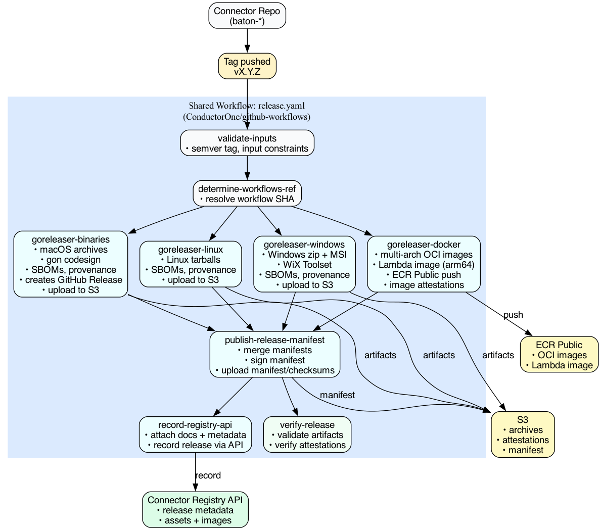

# Release Workflow

The `release.yaml` workflow handles the complete release process for connector repositories, including building, signing, attestation, and publishing.

## Overview



When a tag is pushed to a connector repository, the shared release workflow:

1. Builds binaries for macOS and Linux (with Apple codesigning)
2. Builds Windows zip and MSI installer (with WiX Toolset)
3. Builds multi-arch Docker images
4. Signs all artifacts with Sigstore (keyless)
5. Generates SLSA provenance attestations
6. Publishes to S3 and ECR Public
7. Records the release in the connector registry API

## Jobs

### validate-inputs

Validates workflow inputs before proceeding:

- Ensures tag is valid semver starting with 'v' (e.g., `v1.2.3`)
- Ensures `release_storage_name`, when set, matches
  `^[a-z][a-z0-9-]{0,99}$`
- Ensures `dockerfile_template` is only used when `lambda: false`
- Ensures `docker_extra_files` is only used when `dockerfile_template` is set
- Ensures `GORELEASER_PRO_KEY` is provided when `msi: true`

### determine-workflows-ref

Resolves the exact SHA of the shared workflow, then uses the pinned workflow source to normalize `go_main_package` and `brew_tap`. An omitted main package becomes `./cmd/<repository-name>`; a root package uses `./`. The workflow rejects non-relative package paths and tap values containing a path separator. The pinned reference is embedded in all provenance attestations, ensuring verifiability.

Before option normalization, the pinned checkout validates `dockerfile_template`,
`msi_wxs_path`, `windows_pre_build_script`, and trimmed `docker_extra_files`
entries through `scripts/validate-safe-relative-path.sh`. The helper has the
single safe-path predicate; callers retain their existing diagnostics and
empty-input guards.
These guarded checks run after the existing pinned checkout rather than adding
an unpinned fetch or permissions to `validate-inputs`; all builds already depend
on `determine-workflows-ref`. No job dependencies or permissions change.

### release-preflight

Runs opted-in source integrity checks against the exact tagged caller source before any build job:

- `go_source_hygiene` runs `go generate ./...` and `go mod tidy`, then rejects a changed tree.
- `go_vulnerability_scan` runs `govulncheck` for Linux, macOS, and Windows.

`verify_module_version` checks a generated binary after GoReleaser and before provenance or artifact upload. It requires the embedded Go module version to equal the release tag.

### goreleaser-binaries (macOS)

Builds and signs binary archives for macOS and Linux:

- Cross-compiles for darwin/linux (amd64/arm64)
- Apple codesigning via gon (macOS only)
- Generates SBOMs using Syft
- Creates SLSA v1 provenance attestations
- Signs SBOMs as attestation bundles
- Uploads all artifacts to S3 with no-overwrite writes
- Writes the Homebrew formula GoReleaser rendered to the `conductorone` tap
  (`scripts/publish-homebrew-formula.sh`), re-reading and retrying when a
  concurrent release moved the tap's branch; a formula already at the same
  content is left alone

**Outputs:** `*.zip` (macOS), `*.tar.gz` (Linux), `*.provenance.sigstore.json`, `*.sbom.sigstore.json`

### goreleaser-windows (Windows)

Builds Windows zip and MSI installer:

- Native Windows build on Windows runner (not cross-compiled)
- Produces both `.zip` archive and `.msi` installer
- MSI built using WiX Toolset with GoReleaser Pro
- Deterministic UpgradeCode via UUID v5 from repository name
- Supports custom WXS templates via `msi_wxs_path` input
- Supports an opt-in caller Bash script via `windows_pre_build_script`
- Generates SBOMs and SLSA v1 provenance attestations
- Uploads all artifacts to S3 with no-overwrite writes

**Outputs:** `*.zip`, `*.msi`, `*.provenance.sigstore.json`, `*.sbom.sigstore.json`

**Custom WXS:** For connectors requiring custom MSI behavior (Windows Service, registry keys, etc.), provide a custom WXS template via `msi_wxs_path`. If not provided, uses the default CLI installer template.

**Windows pre-build script:** `windows_pre_build_script` defaults to empty,
preserving the original rendered GoReleaser config without a hook. When set,
Windows config generation verifies that the safe repo-relative path exists as a
file in `_caller`. The config adds a `before.hooks` command, `bash ./<path>`,
which GoReleaser runs in that same tagged caller checkout after its normal
clean-tree/tag validation and before compilation. Only the Windows GoReleaser
step forwards `RELEASE_TAG` from the validated `tag` input to the hook. Hook
failures fail the release; generated resources remain local to the Windows
build workspace. The workflow does not run this hook on macOS, Linux, Docker,
or callers with the default empty input, and does not skip validation, build
snapshots, retag, or commit generated resources.

### goreleaser-docker (Linux)

Builds and publishes container images:

- Multi-arch Docker images (amd64/arm64)
- Pushes a candidate image to ECR Public
- Promotes the candidate digest to the version tag after preflight
- Updates `latest` as mutable convenience metadata
- Attaches provenance attestations to images (OCI referrers)

**Outputs:** ECR Public images with attached attestations

### publish-release-manifest

Finalizes distributable release artifacts:

- Creates unified checksums file (all platforms)
- Merges binary, Windows, and image manifests
- Signs `manifest.json` and checksums with Sigstore
- Uploads manifest and checksums to S3 with no-overwrite writes
- Exposes the final manifest to the registry API recording job

### record-registry-api

Records release metadata in the connector registry API:

- Reuses the exact manifest uploaded to S3
- Includes documentation and changelog data when present; commit entries that
  repeat a subject within a heading section (routine automation sweeps) are
  folded into one line with a count before the changelog is recorded
- Includes `config_schema.json` and `baton_capabilities.json` when present
- Sends release timestamp, commit SHA, and workflow run metadata
- Retries the record up to five times with doubling waits (10s to 80s) on
  transport errors, 5xx responses, 429, or a 400 whose message reports an
  upstream 5xx from the CDN; other 4xx responses fail immediately

### verify-release

Post-release validation (non-blocking):

- Validates all artifacts are accessible
- Verifies all attestations with cosign
- Logs in to Public ECR with the pull-only `GHA-PublicECRPull` role when the
  release includes a Docker image, so the image attestation pull is not
  subject to the anonymous rate limit
- Triggers Datadog notification on failure

### notify-release-failure

Posts the existing Datadog failure event and adds a failure-count metric via
best-effort curl requests. The metric is an addition to the previous event-only
notification, intended to support future staleness monitoring. The axiomatic
workflow remains event-only; aligning its notification behavior is a low-priority
follow-up. Notification API failures cannot fail the reporting job.

## Security Properties

### Pinned Container Images

The default Dockerfile templates select immutable multi-architecture base-image
indexes. Buildx selects the target platform from each index; the Lambda build
continues to select Linux arm64. `tools/image-locks.txt` records each image
reference, index digest, and UTC resolution date. QEMU and the docker-container
BuildKit driver use pinned helper-image locks. Renovate managers track these
image references and `.github/actions/locked-tools/tool-locks.txt`.

Committed image references and digests:

| Image reference / lock line or distroless platform | Index / platform manifest digest |
| --- | --- |
| `gcr.io/distroless/static-debian13:nonroot` | `sha256:d62067879de890a1def9da0e7766b7d20810a5e5555cef8506b752437d7a3e88` |
| ↳ `linux/amd64` | `sha256:d4df213e27178b79e05ee2bdf8a23d8c54baab3b5a0dc083b039ad9929fa4219` |
| ↳ `linux/arm64/v8` | `sha256:8a198f3cf5e9b249577c18010ec18382a3e9f94a6e5676d57b1ff8438ae113e9` |
| ↳ `linux/arm/v7` | `sha256:38489751a0d2feecbe3b7a840d979e6c4db380558f15c61ee025f378b84b2cf3` |
| ↳ `linux/s390x` | `sha256:c63ef2a68c5ffa9bd31feaa573d606208c10d54b1bee2caf3c168dc5ddec78d9` |
| ↳ `linux/ppc64le` | `sha256:be4a6d22e53c1118d0c026dc08be71ec3f1954ae75f6e5ff4a10ce97b837ff80` |
| ↳ `linux/riscv64` | `sha256:0b160fd367891825201f06378982d59900bf35992cfcc453daf7449892d91226` |
| `public.ecr.aws/lambda/provided:al2023` | `sha256:49c8b85e353ea6052759c3dcf6761b35c055c29c8016a9cd734ac4d24a060729` |
| `tonistiigi/binfmt:latest` | `sha256:400a4873b838d1b89194d982c45e5fb3cda4593fbfd7e08a02e76b03b21166f0` |
| `moby/buildkit:buildx-stable-1` | `sha256:cec9f139f45e93c5c69c60f8b07cfad9f43f4ef6b6a6cd917527fea5ff2e3dea` |

Distroless image-config creation times use the Unix epoch for reproducibility;
registry manifest metadata identifies publication time. The runtime base uses
the pinned Distroless index. Lambda uses the pinned AL2023 base; its certificate
bundle is independent of the Go 1.27.3-or-newer runtime's incident-key distrust.
Helper-image digest pins identify the exact QEMU and BuildKit code used by builds.

`scripts/check-image-locks.sh` checks repository Dockerfile `FROM` declarations
(including documented examples), helper driver image assignments, and YAML image
inputs for complete SHA-256 pins. The repository's pull-request workflow runs the
check and its isolated positive/negative fixture tests without release secrets.
Custom Dockerfiles in caller repositories are still the caller's responsibility.
Test sources under `scripts/test-*` are excluded; `FROM scratch` and `FROM <stage>` multi-stage forms fail closed unless explicitly annotated with `# image-locks: ignore` on the immediately preceding line for Dockerfiles (trailing comments are not allowed); shell/YAML annotations may be inline.

#### Updating Locks

`renovate.json` adds Dockerfile-template discovery and regex managers for image
locks, helper workflow inputs and setup script, the README's Java example, and tool locks.
Enable the Renovate app for this repository to activate these rules; configuration
alone does not grant the app access. Digest refreshes are grouped into reviewable
PRs, with no automerge. Image tags are retained as readable update channels, not
trusted build identities.
Tagless QEMU and BuildKit execution references are tracked against explicit
`latest` and `buildx-stable-1` update channels, respectively; refreshes replace
their digests without adding mutable tags to the execution references.

Neither Dependabot nor Renovate refreshes this repository's artifact SHA256
values automatically. Regex managers open draft version proposals for the
locked tools; each artifact entry still requires a matching URL and checksum.
Gon's `# gon-release <tag>` marker and source commit are tracked together
against `ConductorOne/gon` tags.

Tool lock entries keep each platform's version, artifact URL and SHA256 together;
installers reject a version/URL mismatch. Gon identifies source by immutable
commit. Image lock entries, templates and helper inputs use the same immutable
index digest, and the lock table records each selected reference and digest.

### Immutable S3 Release Objects

Versioned release objects are uploaded through S3 `PutObject` with
`If-None-Match: *`. Existing objects under
`releases/{org}/{release_storage_name}/{tag}/...` cause the release to fail
instead of being overwritten. When `release_storage_name` is not set, the
workflow uses the repository name, preserving the existing connector path.

### Public ECR Version Tags

Public ECR image publication writes a temporary candidate tag first. The
workflow compares that candidate digest to any existing version tag before
publishing the version tag. A matching digest is allowed; a different digest is
rejected. The `latest` tag is updated after the version check and is not used
in release identity data.

### Release Source Identity

Release jobs check out caller code by the caller event's `${{ github.sha }}`,
not by a mutable tag reference. `scripts/verify-release-checkout.sh` requires
both HEAD and `refs/tags/<tag>^{commit}` to equal that event SHA before building
or recording metadata. Peeling supports lightweight and annotated tags; a
missing tag, a moved tag, or an event SHA that is a tag object fails closed.
The same event commit remains in the provenance's resolved Git dependency.

Every GoReleaser invocation receives `GORELEASER_CURRENT_TAG` from the workflow input. This pins archive names, release metadata, and image digest files to the requested tag when multiple tags identify the same commit.

### Release Job Bootstrap

Nine release jobs first check out `_workflows` at `${{ job.workflow_sha }}`
with a SHA-pinned checkout action and `persist-credentials: false`. This fetch
necessarily precedes the guard and, like the runner's own action downloads,
authenticates to github.com with the job's read-scoped `GITHUB_TOKEN`
(actions/checkout requires a token); the token is not persisted, the host is not
behind the incident intermediates, and content integrity is bound to
`job.workflow_sha`. This read-only infrastructure checkout provides the
workflow's own action implementations and canonical lock; it does not execute
caller code.
The job then runs `./_workflows/.github/actions/ca-trust-guard` with its default
`enforce`/`true`/`true`/`fail` inputs. Six tool-using jobs next run
`./_workflows/.github/actions/locked-tools` with `id: tools`, before caller
checkout, release-commit verification, module requirements, and credentials.
The workflow uses no remote self-action SHA references: its workflow, local
actions, and lock come from the same checkout commit. The guard's measurements
and residual-client limits are documented in
[CA Trust Guard](../.github/actions/ca-trust-guard/README.md).

`notify-release-failure` is deliberately exempt: guard errors must not prevent
failure reporting. The job remains failure-only and does not install build
tools. `validate-inputs`, `determine-workflows-ref`, and `verify-release` need
the guard but no locked-tools installation.

| Tool-using job | `locked-tools` input |
| --- | --- |
| release-preflight | `go` |
| goreleaser-binaries | `go,gon,syft,goreleaser` |
| goreleaser-windows | `go,syft,goreleaser-pro` |
| goreleaser-docker | `go,goreleaser` |
| publish-release-manifest | `go` |
| record-registry-api | `go` |

The preflight `_workflows` checkout and local guard always run. Its
`go_source_hygiene || go_vulnerability_scan` condition applies to locked-tools,
caller checkout, source verification, and the module gate, so disabling both
optional checks does not download a Go toolchain.
Tool-using jobs set `GOTOOLCHAIN=local` at job scope. The binaries job also sets
`GOFLAGS=-mod=readonly`, `GOPROXY=https://proxy.golang.org`, and
`GOSUMDB=sum.golang.org` at job scope. Cosign and bundled-buildx/QEMU setup run
after trust/tool bootstrap and before their signing or AWS credentials.

### Privileged Action Allowlist

`tools/privileged-actions.txt` is the reviewed third-party action repository
allowlist. First-party `actions/*` actions are allowed separately, including
the App-token mint action; every remote action must use a full 40-character
commit SHA. A version comment is informational, not the execution reference.
`scripts/check-release-actions.py`, exercised by `make test-scripts` in repository
CI, checks every job with `id-token: write` or a secret reference, plus the
explicit credential-bearing job inventory. It also checks the implementations
of the two permitted local composite actions so they cannot hide a new remote
action. Unknown local paths and container actions fail closed.

The local guard and locked-tools actions come from the immutable `_workflows`
checkout at `job.workflow_sha`; they are not third-party downloads. The remaining
action inventory is below (counts include repeated conditional steps):

| Job | Action | Class | Count | Why it remains |
| --- | --- | --- | --- | --- |
| validate-inputs | actions/checkout | First-party | 1 | Fetch the pinned workflow implementation. |
| validate-inputs | ca-trust-guard (local) | Local | 1 | Enforce runner trust before validation. |
| goreleaser-binaries | actions/checkout | First-party | 2 | Fetch pinned workflow and exact caller source. |
| goreleaser-binaries | ca-trust-guard / locked-tools (local) | Local | 1 each | Enforce trust and install checksum-verified tools. |
| goreleaser-binaries | sigstore/cosign-installer | Third-party | 1 | Bootstrap the pinned signing tool. |
| goreleaser-binaries | apple-actions/import-codesign-certs | Third-party | 1 | Import the Apple signing identity into the temporary keychain. |
| goreleaser-binaries | aws-actions/configure-aws-credentials | Third-party | 1 | Exchange job OIDC for the artifact publishing role. |
| goreleaser-windows | actions/checkout | First-party | 2 | Fetch pinned workflow and exact caller source. |
| goreleaser-windows | ca-trust-guard / locked-tools (local) | Local | 1 each | Enforce trust and install checksum-verified tools. |
| goreleaser-windows | sigstore/cosign-installer | Third-party | 1 | Bootstrap the pinned signing tool. |
| goreleaser-windows | aws-actions/configure-aws-credentials | Third-party | 1 | Exchange job OIDC for the artifact publishing role. |
| goreleaser-docker | actions/checkout | First-party | 2 | Fetch pinned workflow and exact caller source. |
| goreleaser-docker | ca-trust-guard / locked-tools (local) | Local | 1 each | Enforce trust and install checksum-verified tools. |
| goreleaser-docker | sigstore/cosign-installer | Third-party | 1 | Bootstrap the pinned signing tool. |
| goreleaser-docker | docker/setup-qemu-action | Third-party | 1 | Enable arm64 builds with a digest-pinned binfmt image. |
| goreleaser-docker | aws-actions/configure-aws-credentials | Third-party | 2 | Assume the separate public and Lambda publishing roles. |
| goreleaser-docker | aws-actions/amazon-ecr-login | Third-party | 2 | Authenticate to public and private ECR. |
| publish-release-manifest | actions/checkout | First-party | 1 | Fetch the pinned workflow implementation. |
| publish-release-manifest | ca-trust-guard / locked-tools (local) | Local | 1 each | Enforce trust and install checksum-verified tools. |
| publish-release-manifest | sigstore/cosign-installer | Third-party | 1 | Bootstrap manifest signing. |
| publish-release-manifest | aws-actions/configure-aws-credentials | Third-party | 1 | Exchange job OIDC for manifest publication. |
| record-registry-api | actions/checkout | First-party | 2 | Fetch pinned workflow and exact caller metadata. |
| record-registry-api | ca-trust-guard / locked-tools (local) | Local | 1 each | Enforce trust and install checksum-verified tools. |
| record-registry-api | actions/github-script | First-party | 1 | Request the registry-audience OIDC token and mask it. |
| verify-release | actions/checkout | First-party | 1 | Fetch the pinned verification implementation. |
| verify-release | ca-trust-guard (local) | Local | 1 | Enforce runner trust before verification. |
| verify-release | sigstore/cosign-installer | Third-party | 1 | Bootstrap signature verification. |
| verify-release | aws-actions/configure-aws-credentials | Third-party | 1 | Assume the pull-only Public ECR role. |
| verify-release | aws-actions/amazon-ecr-login | Third-party | 1 | Avoid anonymous pull throttling during verification. |
| notify-release-failure | None | — | 0 | Post the existing Datadog event and a failure-count metric via curl. |

The locked-tools composite additionally uses one SHA-pinned first-party
`actions/checkout` to fetch the locked gon source. `docker/setup-buildx-action`
is allowed but not currently used: Buildx comes from locked-tools. The mint
action is allowed but this workflow does not currently need an App private key.
The allowlist reduces download exposure; it does not eliminate the runner's
pre-step action downloads. Datadog reporting preserves the existing event title,
host, tags and details; API errors are best-effort and cannot fail the reporting
job. Offline fixtures exercise both successful and rejected API requests.
Live release and forced-failure rehearsals remain separate rollout checks.

### Locked Release Tools

`.github/actions/locked-tools/tool-locks.txt` identifies tool versions, artifact
URLs and committed SHA256 values. The action-local Bash and PowerShell installers
fetch the selected URL, verify its hash **before extraction**, and check the
expected executable leaf before publishing PATH. They do not execute downloaded
binaries during extraction. The action's Go assertion and native gon build run
after verified installation. Release credentials are configured only after
tool installation and checks. Helper code checkouts use `job.workflow_sha`.

Go is installed once per tool-using job, with `GOTOOLCHAIN=local`. Each of the
six module gates invokes the checked-out action-local `verify-locked-go.sh`
after source verification and receives the installed action's identity:

- `EXPECTED_GO_VERSION`: `${{ fromJSON(steps.tools.outputs.versions || '{}').go }}`
- `EXPECTED_LOCK_SHA256`: `${{ steps.tools.outputs.lock_sha256 }}`
- `LOCK_PATH`: `${{ steps.tools.outputs.lock_path }}`

The empty-JSON expression is safe when optional tools are skipped: step
environments are evaluated before step conditions. It supplies no version
fallback; an executing gate with incomplete outputs fails closed.
The gate hashes the referenced lock to check identity but never parses its
versions; prepare owns the single-version sanity. Version equality and
readonly/offline `GOTOOLCHAIN=local go list -m` checks reject incompatible module
requirements. The action asserts the installed Go version itself; the workflow
does not duplicate standalone version gates or cache Go modules.

Artifact hashes identify the archives at the upstream release URLs.
[Go release metadata](https://go.dev/dl/?mode=json) provides the toolchain
checksums. Checksums and artifacts share upstream TLS origins; release
integrity uses the committed lock rather than a checksum fetched during the job.

Node.js 26.12.1 uses platform-specific archive locks with checksums from [SHASUMS256.txt](https://nodejs.org/dist/v26.12.1/SHASUMS256.txt).

The local `./_workflows/.github/actions/locked-tools`
composite action accepts a comma-separated `tools` list, an optional reviewed
`locks` file (default: the action's canonical lock), and `dest` (default:
`${{ runner.temp }}/locked-tools`). Invoke it before configuring release
credentials. Supported tools are `go`, `node`, `syft`, `goreleaser`,
`goreleaser-pro`, `gon`, and `minisign`; missing platform locks and unknown or
duplicate tool names fail closed. Requesting `gon` automatically adds Go,
installs/verifies it first, then builds the SHA-checked-out gon source with the
existing readonly-module/proxy/checksum-database constraints.
Node is supported on Linux amd64, macOS arm64, and Windows amd64. The Windows
installer verifies the ZIP hash before extraction, checks the nested
`node-v26.12.1-win-x64/node.exe` leaf, and publishes that package directory to PATH.

An empty `locks` input selects the action-local canonical lock inside prepare.
`dest` keeps its `runner.temp` metadata default: that context is available in
the caller on Linux, macOS, and Windows.

Outputs include each installed tool's version (`gon` reports its source commit),
a `versions` JSON object, `lock_sha256`, and absolute `lock_path` for provenance.
The path identifies the action-local canonical lock by default, or the actual
reviewed override used. The action verifies that lock bytes have not changed
between preparation, installation, and output publication; internal Go gates
receive the same expected version/path/hash. Each phase is a one-line script
call in the composite. See the [action contract](../.github/actions/locked-tools/README.md).

The action-local Go gate is environment-only. It consumes the installed
action's version and lock-identity outputs, not a version re-read from a
checkout lock or positional lockfile arguments. Canonical implementations
and the single lock reside under `.github/actions/locked-tools/`; forwarding
wrappers under `scripts/` are not supported.

| Tool / version | Lock platform | SHA256 or source commit | Committed artifact/source |
| --- | --- | --- | --- |
| goreleaser v2.13.3 | linux/amd64 | `4b66f2f78f78561330350651ade557b70328664718490f37834749073af21d20` | [Linux archive](https://github.com/goreleaser/goreleaser/releases/download/v2.13.3/goreleaser_Linux_x86_64.tar.gz) |
| goreleaser v2.13.3 | darwin/arm64 | `5516c37779efb3935d5b213cda3b0b9025ae94ddbcb51df6919acbcdef4194b0` | [Universal Darwin archive](https://github.com/goreleaser/goreleaser/releases/download/v2.13.3/goreleaser_Darwin_all.tar.gz) |
| goreleaser-pro v2.13.3 | windows/amd64 | `8f65fca431ae6aa083805c9287d4b98b7937d54649712f1185b0590ae02001de` | [Windows archive](https://github.com/goreleaser/goreleaser-pro/releases/download/v2.13.3/goreleaser-pro_Windows_x86_64.zip) |
| gon v0.2.10 | darwin/* | `f4c3f2be10a2ee8d50067d2c8a8828a14c83977c` (Git commit, not SHA256) | [Pinned source](https://github.com/ConductorOne/gon/commit/f4c3f2be10a2ee8d50067d2c8a8828a14c83977c) |
| syft v1.42.3 | linux/amd64 | `0d6be741479eddd2c8644a288990c04f3df0d609bbc1599a005532a9dff63509` | [Linux archive](https://github.com/anchore/syft/releases/download/v1.42.3/syft_1.42.3_linux_amd64.tar.gz) |
| syft v1.42.3 | darwin/arm64 | `d71ee7db2be0fe2e96f679fd9d69ef04274cc86c8604707797080a21070b3f32` | [Darwin archive](https://github.com/anchore/syft/releases/download/v1.42.3/syft_1.42.3_darwin_arm64.tar.gz) |
| syft v1.42.3 | windows/amd64 | `e1b9f4945aa64c2b34970bec617623d7f803d0661b48a50b966768b363322e2d` | [Windows archive](https://github.com/anchore/syft/releases/download/v1.42.3/syft_1.42.3_windows_amd64.zip) |
| go go1.27.3 | linux/amd64 | `65efbc80fdc1fa2cd2631cad5b481777a68e8725f34e89f50fc6ac714e379b40` | [Linux toolchain](https://go.dev/dl/go1.27.3.linux-amd64.tar.gz) |
| go go1.27.3 | linux/arm64 | `a06e99309dbcbdca1a8ccd2282c3ee146e55930886e26b4f1193269587165f49` | [Linux arm64 toolchain](https://go.dev/dl/go1.27.3.linux-arm64.tar.gz) |
| go go1.27.3 | darwin/arm64 | `dd3908cf20959d798c1e06ebe5b72213f0505ce01373b40ce3110975a6cd99c2` | [Darwin toolchain](https://go.dev/dl/go1.27.3.darwin-arm64.tar.gz) |
| go go1.27.3 | windows/amd64 | `f26081f438319757f8a1b46d7d0b2c5ec7583d4038e485e0aa725cfde7885fff` | [Windows toolchain](https://go.dev/dl/go1.27.3.windows-amd64.zip) |
| node v26.12.1 | linux/amd64 | `0fd1eb7770598f52a21995edf6ed35fc690400fa437c2386af329519e9143132` | [Linux package](https://nodejs.org/dist/v26.12.1/node-v26.12.1-linux-x64.tar.gz) |
| node v26.12.1 | darwin/arm64 | `1901d539912c02afa10d1cc126943a8855a7eedebe830119463470db5e6c59e8` | [Darwin package](https://nodejs.org/dist/v26.12.1/node-v26.12.1-darwin-arm64.tar.gz) |
| node v26.12.1 | windows/amd64 | `b3efd5c70cba3308ed46e7e699a9b8aac075bbc6b027fcb39c84c31acc25e2b4` | [Windows package](https://nodejs.org/dist/v26.12.1/node-v26.12.1-win-x64.zip) |
| minisign 0.12 | darwin/arm64 | `89000b19535765f9cffc65a65d64a820f433ef6db8020667f7570e06bf6aac63` | [macOS ZIP](https://github.com/jedisct1/minisign/releases/download/0.12/minisign-0.12-macos.zip) |

Gon builds natively from a pinned source commit with the verified Go toolchain.
The action checks out the exact source object, checks its Go requirement, and
requires `GOFLAGS=-mod=readonly`, `GOPROXY=https://proxy.golang.org` and
`GOSUMDB=sum.golang.org`. It records the resulting binary's SHA256.

Cosign v2.5.2 is installed by
`sigstore/cosign-installer@398d4b0eeef1380460a10c8013a76f728fb906ac`.
That action verifies its bootstrap binary against hashes embedded in the
pinned action and verifies other requested versions by signature.

Buildx is never downloaded: `scripts/setup-release-buildx.sh` prints the
runner-bundled plugin's version, fails if it is absent, and creates a builder
with `moby/buildkit@sha256:cec9f139f45e93c5c69c60f8b07cfad9f43f4ef6b6a6cd917527fea5ff2e3dea`.
QEMU uses `tonistiigi/binfmt@sha256:400a4873b838d1b89194d982c45e5fb3cda4593fbfd7e08a02e76b03b21166f0`.
The setup-buildx action was not retained because even `install: false` can
download a plugin when the runner's plugin is unavailable.


### Keyless Signing

All signatures use Sigstore's keyless signing:

- No long-lived keys to manage or rotate
- Identity based on GitHub Actions OIDC token
- Signatures recorded in Rekor transparency log
- Workflow signing and attestation steps run cosign through
  `scripts/cosign-retry.sh`: three attempts with a 10 s then 20 s wait
  (`COSIGN_RETRY_ATTEMPTS`, `COSIGN_RETRY_DELAY`), since the OIDC token
  endpoint and Fulcio fail transiently under load and a repeated signing
  call is harmless

### Provenance Attestations

Every artifact includes SLSA v1 provenance that links it to:

- Source repository and commit
- Workflow that built it (pinned SHA)
- Build environment (runner OS, architecture)
- Build timestamp

### SBOM Attestations

Software Bill of Materials (SPDX format) for each binary:

- Generated by Syft during build
- Signed as in-toto attestation
- Links SBOM to the specific artifact

### Windows MSI Installers

MSI installers are built using WiX Toolset with GoReleaser Pro:

- **UpgradeCode:** Deterministic UUID v5 generated from repository name, ensuring consistent upgrade behavior across versions
- **Default template:** Installs to `C:\Program Files\ConductorOne\<connector>` and adds to PATH
- **Custom templates:** Connectors can provide custom WXS via `msi_wxs_path` input for Windows Service, registry keys, etc.

The MSI uses a WiX-compatible version format (`x.x.x.0`) since WiX doesn't support semver prerelease suffixes.

Both Windows zip and MSI have:
- Cosign signatures (`.sig`, `.cert`)
- SLSA provenance attestations
- SBOM attestations

Windows artifacts have Sigstore signatures, not Windows Authenticode signatures.

### Verification

Anyone can verify artifacts using cosign:

```bash
# Verify binary provenance
cosign verify-blob-attestation \
  --bundle artifact.provenance.sigstore.json \
  --type https://slsa.dev/provenance/v1 \
  --certificate-oidc-issuer https://token.actions.githubusercontent.com \
  --certificate-identity-regexp 'https://github.com/ConductorOne/github-workflows/.github/workflows/release.yaml@.*' \
  artifact.zip

# Verify image provenance
cosign verify-attestation \
  --type https://slsa.dev/provenance/v1 \
  --certificate-oidc-issuer https://token.actions.githubusercontent.com \
  --certificate-identity-regexp 'https://github.com/ConductorOne/github-workflows/.github/workflows/release.yaml@.*' \
  public.ecr.aws/conductorone/baton-foo@sha256:abc123
```

### Certificate Identity

All attestations are signed with a certificate containing:

- **Issuer:** `https://token.actions.githubusercontent.com`
- **Identity:** `https://github.com/ConductorOne/github-workflows/.github/workflows/release.yaml@<ref>`

Verification requires matching both issuer and identity pattern.

## Directory Structure

```
$GITHUB_WORKSPACE/
├── _caller/              # Connector repo checkout
│   └── dist/             # GoReleaser output, attestation bundles
└── _workflows/           # github-workflows repo checkout
    ├── _generated/       # Generated configs (goreleaser, gon, predicate)
    ├── _output/          # Final manifest and signatures
    ├── templates/        # Source templates
    └── cmd/              # Go commands
```

## S3 File Structure

```
releases/{org}/{release_storage_name}/{tag}/
├── manifest.json
├── manifest.json.sig
├── manifest.json.cert
├── baton-foo_1.0.0_checksums.txt
├── baton-foo_1.0.0_checksums.txt.sig
├── baton-foo_1.0.0_checksums.txt.cert
├── baton-foo-v1.0.0-darwin-arm64.zip
├── baton-foo-v1.0.0-darwin-arm64.zip.sig
├── baton-foo-v1.0.0-darwin-arm64.zip.cert
├── baton-foo-v1.0.0-darwin-arm64.zip.provenance.sigstore.json
├── baton-foo-v1.0.0-darwin-arm64.zip.sbom.sigstore.json
├── baton-foo-v1.0.0-linux-amd64.tar.gz
├── baton-foo-v1.0.0-linux-amd64.tar.gz.sig
├── baton-foo-v1.0.0-linux-amd64.tar.gz.cert
├── baton-foo-v1.0.0-linux-amd64.tar.gz.provenance.sigstore.json
├── baton-foo-v1.0.0-linux-amd64.tar.gz.sbom.sigstore.json
├── baton-foo-v1.0.0-windows-amd64.zip
├── baton-foo-v1.0.0-windows-amd64.zip.sig
├── baton-foo-v1.0.0-windows-amd64.zip.cert
├── baton-foo-v1.0.0-windows-amd64.zip.provenance.sigstore.json
├── baton-foo-v1.0.0-windows-amd64.zip.sbom.sigstore.json
├── baton-foo_v1.0.0_windows_amd64.msi
├── baton-foo_v1.0.0_windows_amd64.msi.sig
├── baton-foo_v1.0.0_windows_amd64.msi.cert
├── baton-foo_v1.0.0_windows_amd64.msi.provenance.sigstore.json
├── baton-foo_v1.0.0_windows_amd64.msi.sbom.sigstore.json
└── ...
```

## Testing Changes

### Repository CI

`.github/workflows/ci.yaml` runs repository-owned Go vet/tests, `make test-scripts`,
and ShellCheck for relevant pull requests and pushes to `main`, with read-only
contents permission and no secrets. The reusable `verify.yaml` remains scoped
to connector callers. Real image-pin enforcement stays in the existing
`general-pr-review.yaml` image-locks job rather than adding a duplicate CI job.

CI installs ShellCheck and script-test dependencies through Ubuntu 24.04 apt.
The tests select apt's Python/jq `yq` ahead of the runner's different `yq`.
`bash scripts/lint-shell.sh` checks every repository Bash source, including
action implementations, guard scripts, tests and repository helper entrypoints.
Local lifecycle fixtures also verify connector failure propagation without
calling a live connector.

### Test Repositories

Use test connectors for validation:

- `ConductorOne/baton-runner` - Custom WXS template testing (via `msi_wxs_path` at `ci/app.wxs`)
- `ConductorOne/baton-github-test` - Default WXS template testing

### Testing Process

1. Make workflow changes on a branch
2. Point test repo at your branch:
   ```yaml
   uses: ConductorOne/github-workflows/.github/workflows/release.yaml@your-branch
   ```
3. Create a test release on test connector repo via UI
4. Wait for workflow to complete
5. Validate outputs:
   ```bash
   ./scripts/validate-release-artifacts.sh ConductorOne/baton-github-test v0.1.xxx
   ```

### Local Tool and Source Integrity Checks

`python3 scripts/test-tool-integrity.py` exercises verified archive extraction,
tampered hashes failing before extraction/PATH changes, stale version/URL and
duplicate locks, newer or malformed Go requirements, the source-locked gon
build gates, bundled-buildx failure, and event-SHA checks with both lightweight
and annotated tags. It also checks workflow credential ordering. These are
deterministic local fixtures, not deployed macOS or Windows proof.
Repository CI additionally runs the single Windows Node installer fixture on
`windows-latest`, using real ZIP/hash/extraction/leaf checks and a shadowed
download command, without release secrets. This is native fixture proof, not a
deployed Windows release or signing test.

Before release adoption, run canaries on `ConductorOne/baton-github-test`:
mutate one artifact hash at a time for GoReleaser and Syft and require the
installer to fail before credentials or binary invocation; mutate the gon
source commit and require checkout/verification to fail before certificates.
Run positive lightweight and annotated tag releases with correct locks and
validate the published artifacts with `scripts/validate-release-artifacts.sh`.
Real platform runs, including PowerShell extraction and native macOS gon
compilation/signing, remain mandatory integration evidence.

### Local Windows Hook Checks

`make test-scripts` includes `python3 scripts/test-windows-pre-build-script.py`.
It uses the real workflow Bash steps and `envsubst`, with `yq` for YAML queries:
empty input must match the frozen pre-hook config fixture byte-for-byte; opted-in
scripts must render the expected command; unsafe and missing paths must fail.
The fixture hook also checks the caller working directory, release-tag
forwarding, and command failure propagation without compiling or publishing.
These are local fixture checks, not a deployed Windows release proof.

`python3 scripts/test-safe-relative-path.py` additionally compares the shared
predicate and every workflow/render call site's exit status and diagnostic bytes
against the previous Bash rules, including extra-file trimming and empty guards.

### Validation Script

The `scripts/validate-release-artifacts.sh` script validates:

- Manifest structure and version match
- All binary assets are downloadable
- Provenance and SBOM attestations exist and verify
- ECR Public image attestations (if present)
- Manifest signature (if present)

```bash
./scripts/validate-release-artifacts.sh ORG/REPO VERSION
```

Exit codes: `0` = all passed, `1` = failures

Each cosign verification is retried on failure, three attempts with a 10 s
then 20 s wait by default (`COSIGN_VERIFY_ATTEMPTS`, `COSIGN_VERIFY_DELAY`),
since Rekor and the certificate transparency log time out and rate-limit
under load. cosign's stderr from the final attempt is printed under a failed
check.

### Manual Verification

```bash
# Download and verify binary provenance
curl -LO "https://dist.conductorone.com/releases/ConductorOne/baton-github-test/v0.1.102/baton-github-test-v0.1.102-darwin-arm64.zip"
curl -LO "https://dist.conductorone.com/releases/ConductorOne/baton-github-test/v0.1.102/baton-github-test-v0.1.102-darwin-arm64.zip.provenance.sigstore.json"

cosign verify-blob-attestation \
  --bundle baton-github-test-v0.1.102-darwin-arm64.zip.provenance.sigstore.json \
  --type https://slsa.dev/provenance/v1 \
  --certificate-oidc-issuer https://token.actions.githubusercontent.com \
  --certificate-identity-regexp 'https://github.com/ConductorOne/github-workflows/.github/workflows/release.yaml@.*' \
  baton-github-test-v0.1.102-darwin-arm64.zip
```

### MSI Installation Testing

Test the MSI installer on an actual Windows machine:

1. Download MSI from S3:
   ```powershell
   curl -LO "https://dist.conductorone.com/releases/ConductorOne/baton-runner/vX.Y.Z/baton-runner_vX.Y.Z_windows_amd64.msi"
   ```

2. Install and verify:
   - Double-click MSI or run `msiexec /i baton-runner_vX.Y.Z_windows_amd64.msi`
   - Check installation path: `C:\Program Files\ConductorOne\baton-runner\`
   - Verify PATH includes installation directory
   - Run `baton-runner --help` from new terminal

3. Test upgrade scenario:
   - Install older version first
   - Install newer version over it
   - Verify clean upgrade (no duplicate entries, old version removed)

4. Test uninstall:
   - Uninstall via Settings > Apps or `msiexec /x`
   - Verify files removed from Program Files
   - Verify PATH entry removed

5. Verify UpgradeCode consistency:
   - UpgradeCode is deterministic UUID v5 from repository name
   - Must be identical across all versions for upgrades to work

### Common Issues

- **Cosign version:** Ensure using latest cosign (`cosign version`)
- **MSI UpgradeCode:** If upgrades don't work, verify UpgradeCode is consistent across versions

## Platform Limitations

- Windows artifacts use Sigstore signatures and do not include Windows Authenticode signatures.
- Windows build and toolchain targets use amd64; Windows ARM64 is not supported.
- Windows Service installers require a caller-provided custom WXS template.
